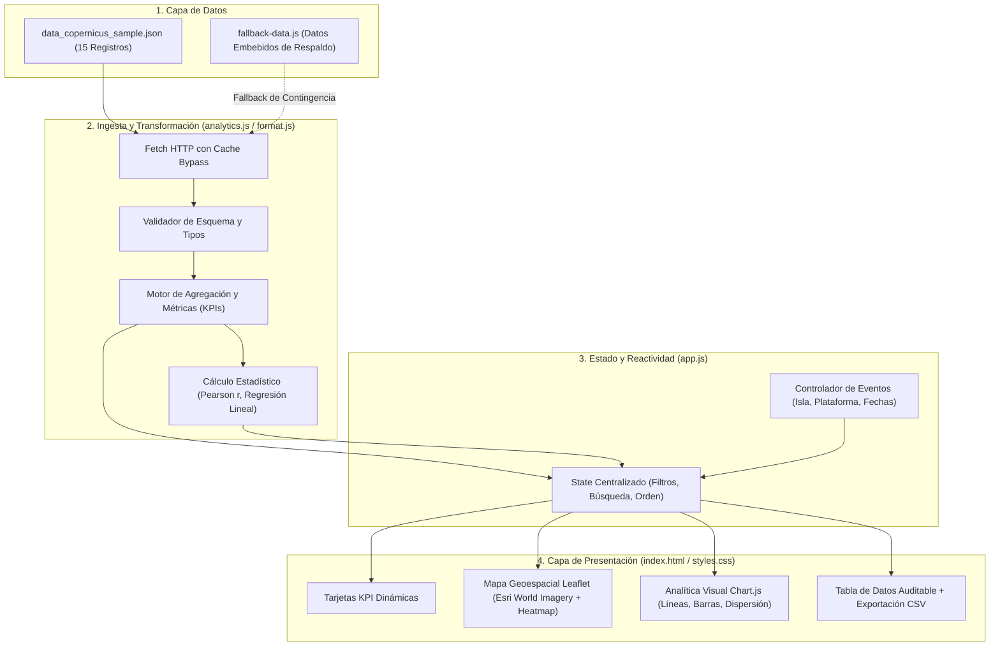

# Arquitectura de Software y Flujo de Datos — PlasTrack

## 1. Visión General de la Arquitectura

PlasTrack implementa una **Arquitectura de Inteligencia de Negocios 100% Estática en Cliente (Jamstack)**. No requiere bases de datos relacionales tradicionales, servidores de aplicaciones con estado ni entornos de compilación pesados. 

El sistema aprovecha las capacidades de los navegadores web modernos para ejecutar la ingesta, validación, cálculo analítico y renderizado reactivo a través de módulos nativos ECMAScript (ES6).

---

## 2. Componentes y Responsabilidades

### A. Capa de Ingesta y Resiliencia (`app.js` + `fallback-data.js`)
- Consume `data/data_copernicus_sample.json` vía `fetch()`.
- **Mecanismo de Respaldo (Fallback):** Si la llamada HTTP falla (por ejemplo, en aperturas locales bajo protocolo `file://`, bloqueos de CORS o latencia de red), el sistema conmuta instantáneamente al conjunto `FALLBACK_RECORDS` exportado por `fallback-data.js`. Esto garantiza que la interfaz nunca quede en blanco ni muestre errores fatales no controlados.

### B. Motor Analítico Puro (`analytics.js`)
- Contiene funciones matemáticas deterministas sin efectos secundarios.
- Realiza:
  - Filtrado multidimensional (Isla, Plataforma, Fechas `desde/hasta`).
  - Cálculo de KPIs globales y diferenciales ($\Delta$ respecto al total).
  - Cálculo de la correlación momento-producto de Pearson ($r$).
  - Regresión lineal simple por mínimos cuadrados ordinarios ($y = mx + b$).
  - Agrupación por isla y distribución de frecuencias.
  - Serialización a formato CSV para auditoría.

### C. Visualización Geoespacial (`map.js`)
- **Librería base:** Leaflet.js 1.9.4.
- **Capa base:** Teselas satelitales de alta resolución de *Esri World Imagery* con conmutación adaptativa de brillo para temas claro/oscuro.
- **Capas temáticas activables:**
  1. *Marcadores:* Puntos geográficos por pasada clasificados por semáforo de aptitud (Verde $\ge 80\%$, Amarillo $60\text{--}79\%$, Rojo $<60\%$).
  2. *Mapa de calor (`leaflet.heat`):* Densidad espectral de observaciones.
  3. *Zonas de acumulación:* Polígonos de amortiguamiento geográfico que denotan frecuencia de pasadas.

### D. Analítica Visual (`charts.js`)
- **Librería base:** Chart.js 4.4.x.
- **Gráficos implementados:**
  1. *Evolución temporal mensual:* Líneas de tendencia de nubosidad y aptitud.
  2. *Ranking insular:* Gráfico de barras horizontal por cobertura de pasadas.
  3. *Dispersión nubosidad vs. aptitud:* Scatter plot con recta de regresión lineal.
  4. *Distribución por plataforma:* Gráfico de pastel/dona para Sentinel-2A, Sentinel-2B y Landsat 9.

---

## 3. Despliegue en GitHub Pages

El proyecto se sirve directamente desde la rama `main` en GitHub Pages:
- Archivo `.nojekyll` en la raíz para evitar que el motor Jekyll omita carpetas con guiones bajos o archivos estáticos.
- Cero dependencias de servidor (Node.js solo se emplea para pruebas unitarias automatizadas con `node --test`).
